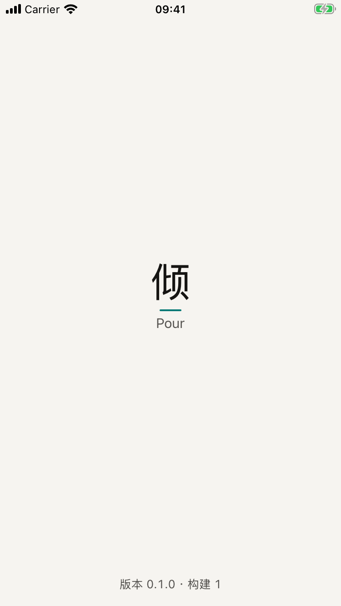
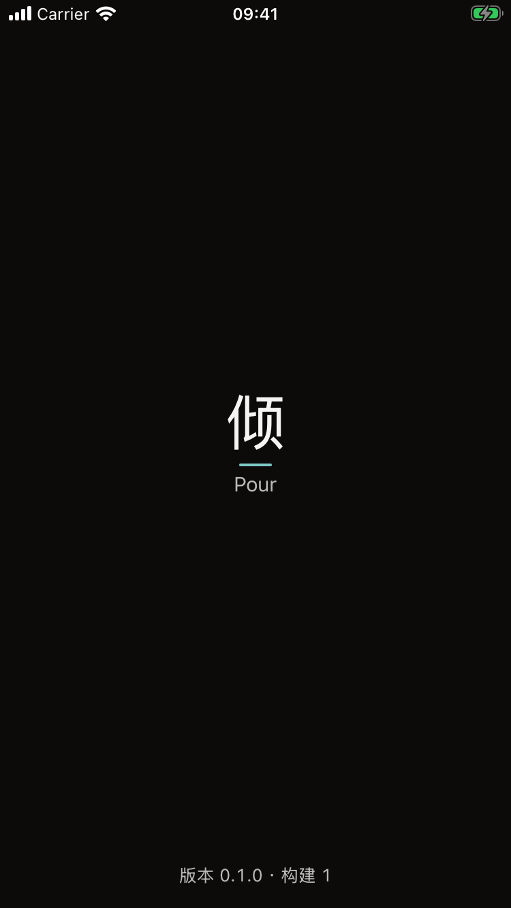
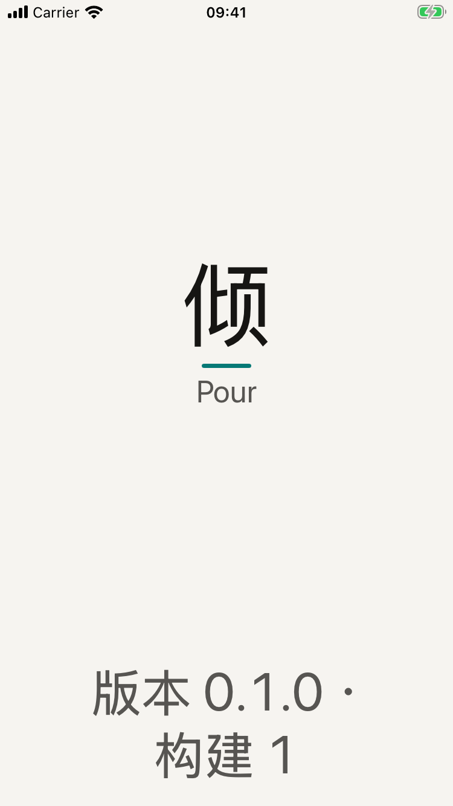
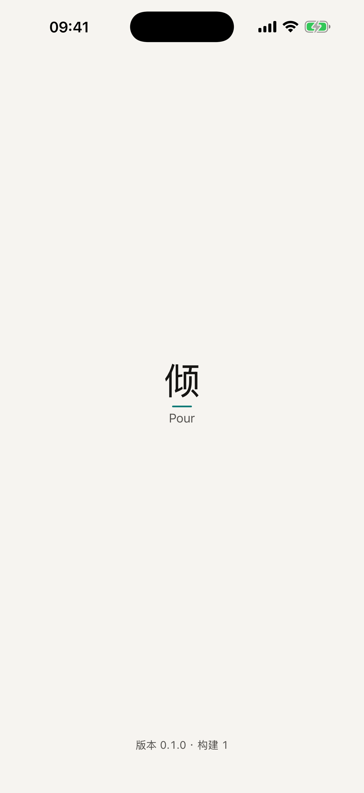
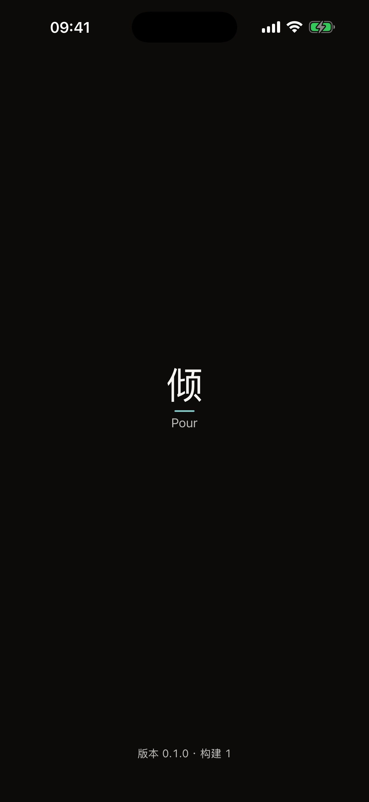
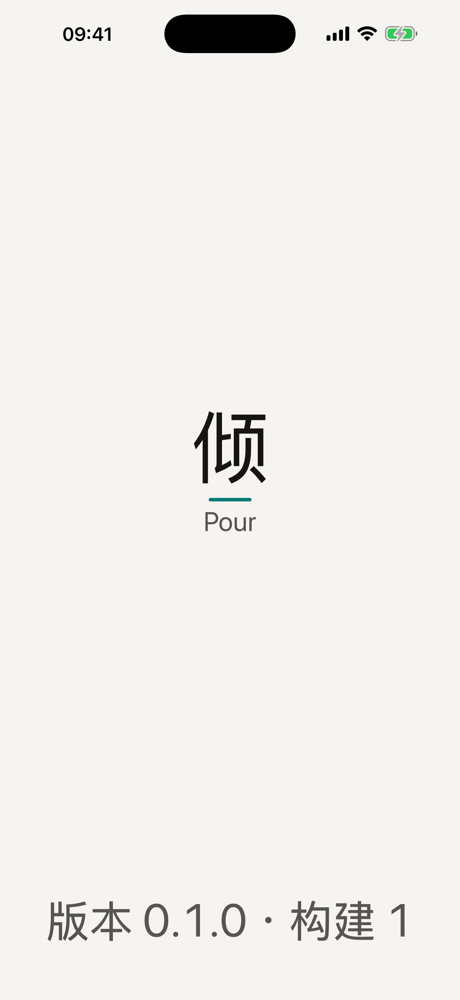

# M0 开工准备 · 自验收报告

> 2026-10-17 · 分支 `feature/ios-m0-setup` · 对照 [M0 小方案](../模块/M0-开工准备.md)

## 一句话结论

**可以交给产品主人验收**：本机的全部检查、GitHub Actions 的 iOS 检查都通过；App 已用数据线装到产品主人的 iPhone 15（iOS 18.7.8，构建 172），产品主人确认能打开。

## 真机和 GitHub（后补，2026-10-17）

| 项目 | 命令 | 结果 |
|---|---|---|
| GitHub Actions iOS 检查 | 合并请求 #13 | **通过**（3 分钟，macos-26 机器） |
| GitHub Actions 网页版检查 | 合并请求 #13 | 类型、单元等通过；**页面测试 2 项失败——`main` 上从 1.17.0 合并起就是这 2 项**（关于我主页顺序、人那一页），不是这个分支改出来的，等产品主人决定是否另开分支修 |
| 装到 iPhone | `scripts/install-device.sh` | 产品主人的 **iPhone 15、iOS 18.7.8**；手机是 iOS 18、只能升到 27，产品主人选「最低系统暂时 iOS 18」（ADR A03）；构建 172 装上，产品主人打开了 |
| 修掉的 | — | 推送前钩子在 Mac 上不可执行（从没生效过）；安装脚本挑了离线的旧手机、没连上时报错看不懂——改成只选现在连着的、没信任时直接说点「信任」；新的配对方式要 Mac 主动发起（`devicectl manage pair`） |

## 做了什么（对照小方案第 3 节）

| # | 内容 | 状态 |
|---|---|---|
| 1 | 一键环境 `scripts/bootstrap.sh` + `Brewfile` | 做了，验过 |
| 2 | XcodeGen 工程 `project.yml`；`PourKit` 五层（PourCore、PourData、PourAI、PourDesign、PourPlatform），依赖方向靠编译器 + `check-deps.py` | 做了，验过 |
| 3 | 只有启动页的空 App：纸色底、字标「倾 · Pour」（`PourBrandMark` 组件）、版本号；亮暗；动态字体到最大不截断；临时图标（亮、暗两套）；只做竖屏 | 做了，模拟器验过；**真机没验** |
| 4 | 隐私清单 `PrivacyInfo.xcprivacy`（不跟踪、不收集、没有需要说明原因的接口） | 做了，验过 |
| 5 | 一键检查 `scripts/check.sh` + 推送前钩子（改了 `ios/` 才跑） | 做了，验过 |
| 6 | GitHub Actions `.github/workflows/ios.yml`（合并请求进 main 时） | 写了，**还没在 GitHub 上跑过** |
| 7 | 主分支保护 | 你决定不开 GitHub Pro → 不开，靠流程（写进 07 第 2 节、CLAUDE.md） |
| 8 | ADR A1–A20 | 做了：[ADR/](../ADR/README.md) |
| 9 | 能力对照表 | 做了：[能力对照表](../归档/能力对照表.md)，10 组 92 条；7 条「改」要你在对应模块确认，2 条「去」写了理由 |
| 10 | 对拍标准答案导出 `scripts/export-golden.ts` | 做了：3 个文件、11 个函数、713 份样例；Swift 的 `jsRound` 已和 330 份 `Math.round` 对拍 |
| 11 | 核对网页版家底 | 做了，见下面「家底核对」 |
| 12 | 文档写回 | 做了：03、01、05、07、README、CLAUDE.md、规范 02、08 第 5.5 节和变更记录 |
| 13 | Node 24 | 做了：用 fnm 装（Homebrew 装 node@24 时卡在升级 OpenSSL，为了不动这台 Mac 上别的程序在用的库，改用 fnm；半装的 OpenSSL 4 已清掉） |
| — | 另加的 | `scripts/install-device.sh`（数据线装手机）、`scripts/screenshots.sh`（截图矩阵）、密钥检查加上苹果的证书和接口密钥 |

## 证明：跑过的命令和真实结果

| 检查 | 命令 | 结果 |
|---|---|---|
| iOS 全部检查（连跑两次，确认稳定） | `scripts/check.sh` | 两次都通过：45 秒、42 秒。其中：swift-format 0 处、SwiftLint（`--strict`）0 处、依赖方向 5 个包 0 处违反、隐私清单格式 OK、Mac 上单元和对拍 8 项通过、App 内部测试 4 项通过（1 项是已知问题，见下）、界面测试 3 项通过（亮色、暗色、最大字号，每项都跑了系统的无障碍审计） |
| 网页版全部检查 | `npm run check` | 通过：类型、令牌、密钥、文案、标准答案是最新的、单元测试 80 个文件 **1,095 项**全过 |
| 密钥检查的新规则 | `npx vitest run scripts/check-secrets.test.ts` | 6 项通过（新加：`.p8 .p12 .mobileprovision Secrets.xcconfig` 拦住、普通工程配置放行） |
| 对拍导出 | `npm run golden`；`npm run golden -- --check` | 导出 3 个文件、11 个函数、713 份样例；核对模式说「是最新的」 |
| 全新克隆装环境 | 在临时目录 `git clone` 本分支 → `scripts/bootstrap.sh` | 5 步全过，**11.8 秒**。如实说明：这台 Mac 已经装过工具，不是全新的 Mac；全新的要多下载 XcodeGen、SwiftLint、Node，估计多几分钟，仍在 15 分钟内（没实测） |
| 测试真的会红（故意埋错，试完改回） | ① `jsRound` 换成 Swift 的 `rounded()` ② PourDesign 声明依赖 PourData ③ App 里写 `Color(red:…)` | ① 对拍和单元测试报「-2.5 网页版是 -2，Swift 算成 -3」② 依赖检查报「PourDesign 不能依赖 PourData」③ SwiftLint 报「不许硬编码颜色」。改回后全部恢复通过 |
| 截图矩阵 | `scripts/screenshots.sh docs/验收/M0` | 6 张：小屏 375 点（iPhone SE）和大屏 440 点（iPhone 17 Pro Max）× 亮、暗、最大字号，都看过（下面） |

### 自验收中发现并改掉的（都改了根因）

| 发现 | 根因 | 改法 |
|---|---|---|
| 界面测试卡死 12 分钟 | 测试收尾用了异步写法，又在等主线程，而主线程在等它 | 改成同步收尾 |
| 界面测试时好时坏，报模拟器「Busy」 | 模拟器刚开机、系统桌面还没准备好就启动 App | 用一台专用的检查模拟器，每次关掉重开、**等它完全开好**再测；连跑两次都过 |
| 检查脚本静默退出 | 取版本号时提前关了管道，在「出错就停」的设置下整个脚本悄悄结束 | 改成读完输出再取第一行 |
| 检查脚本报变量未定义 | 变量后面紧跟中文标点，被当成变量名的一部分 | 两个脚本里所有变量都加花括号 |
| 最大字号时版本号顶到屏幕两边 | 没留左右边距 | 加边距、居中换行 |
| 最大字号时「Pour」比「倾」还大 | 两个字跟着不同的文字样式缩放，放大的比例不一样 | 字标做成设计系统的组件，三样东西按同一条曲线缩放（先试了「给字标封顶」，被系统的无障碍审计拦下：苹果不接受给文字封顶） |
| 截图存错了地方 | 脚本先换目录再用相对路径 | 先换成完整路径 |

## 截图

| | 亮色 | 暗色 | 最大字号 |
|---|---|---|---|
| 小屏（iPhone SE，375 点） |  |  |  |
| 大屏（iPhone 17 Pro Max，440 点） |  |  |  |

## 设计审查清单（这一屏适用的条目）

| 条目 | 结果 | 证据 |
|---|---|---|
| 只用令牌（颜色、字） | 过 | SwiftLint 令牌规则 0 处；埋错能拦住 |
| 青只出现在「懂你」清单里、一屏 ≤ 3 处 | 过 | 只有字标下那一条线（清单第 6 条：启动页的品牌标志） |
| 要读的文字 ≥ 4.5:1 | 过 | 单元测试：墨 16.6、淡墨 6.8、青 4.8（亮色纸上），暗色也全部 ≥ 4.5 |
| 动态字体到最大不截断、不重叠 | 过 | 最大字号截图 + 系统无障碍审计 |
| 旁白有名字 | 过（自动） | 审计通过；字标读「Pour 倾」。**真机旁白走查没做**（要在 iPhone 上） |
| 亮色、暗色都看过；375 和 440 点宽都看过 | 过 | 上面 6 张 |
| 文案：没有感叹号、没有禁用词 | 过 | 只有「版本 0.1.0 · 构建 1」一句 |
| 原话之声用宋体 | **不过（已知问题）** | iPhone 没有预装宋体，「倾」显示的是苹方；M1 给方案（规范 02 已写明） |

## 家底核对（提示词第 2 节的数字，实际数的）

| 项目 | 方案里写的 | 实际 | 怎么数的 |
|---|---|---|---|
| 单元测试 | 1,095 | **1,095** ✓ | `npm run check` |
| 整理评测 | 340 | **340** ✓ | 数 `evals/parse-cases.json` |
| 纠正分类 | 13 | **13** ✓ | 数 `evals/classify-cases.json` |
| 审核员 | 28 | **28** ✓ | 数 `evals/audit-cases.json` |
| 演示数据检查 | 74 | **74/74 通过** ✓ | `npx tsx scripts/check-demo.ts` |
| Skill | 14 份 + 1 份共用 | **14 + `_voice.md`** ✓ | 数 `skills/` |
| 页面测试 | 107 次运行 | **108** ✗ | `npx playwright test --list` |
| `shared/src` 代码 | 约 8,600 行 | **9,403**（不含测试）✗ | `wc -l` |
| `server/src/ai` 代码 | 约 6,500 行 | **4,653**（不含测试；含测试 6,991）✗ | `wc -l` |
| 问答评测 | 48 条 | **仓库里没找到** ✗ | 搜了 `evals/`、`scripts/` |

**整理评测的准确率 99.93% 没有重跑**：要用大模型的密钥、要花钱，属于要你同意的事；M2 动 AI 时会跑。问答评测 48 条的出处要查清，否则 M9 的门槛「不低于现在的 100%」没有基线——M2 前我去另外两台电脑的提交记录里找，找不到就和你商量重建。

## 没跑的、没过的

- **真机旁白走查**：没做（M1 起每个模块做一次）
- **全新 Mac 装环境**：只在这台已经装过工具的 Mac 上测了全新克隆
- **原话之声的宋体**：已知问题，M1 定

## 安全和隐私影响

- App 不联网、不收集、不跟踪；隐私清单和真实行为一致（空）
- 没有任何密钥进仓库：`npm run secrets` 通过；新加的规则拦苹果的证书、接口密钥、描述文件
- 签名团队编号写在 `Config/Local.xcconfig`（不提交，bootstrap 生成）
- 这台 Mac 上动过的：Homebrew 装了 xcodegen、swiftlint、fnm；fnm 装了 Node 24；清掉了自己半装的 OpenSSL 4；建了三台 iOS 模拟器（「Pour 检查」「Pour 截图」×2）

## 怎么退回

全部是新增文件加文档改动，网页版的规则一行没改（只新增了导出脚本、`npm run check` 多了一步核对标准答案、密钥检查多了几条规则）。不合并这个分支，`main` 就和以前一样。

## 已知问题和下一步

1. 你插线装真机，按下面的验收脚本看
2. 推送分支、开合并请求，让 GitHub Actions 跑一次 iOS 检查（不合并，等你验收）
3. M1 前：问答评测 48 条的出处；原话之声用什么字

---

# M0 · 你的验收脚本（约 10 分钟，要在 Mac 旁边）

准备：iPhone 和数据线；Mac 开着。

1. 用数据线把 iPhone 连到 Mac。手机上弹出「要信任此电脑吗」，点**信任**，输入锁屏密码
2. 告诉我「插好了」，我来装（`scripts/install-device.sh`）
3. 第一次装要打开**开发者模式**：手机上 设置 → 隐私与安全性 → 拉到最下面「开发者模式」→ 打开 → 按提示重启 → 重启后点「打开」，输入密码
4. 第一次装还要**信任开发者**：设置 → 通用 → VPN 与设备管理 → 点你的 Apple ID → 「信任」
5. 在主屏幕找到 **Pour**（纸色底、墨色「倾」字的图标），点开
   你应该看到：米白的底，中间一个「倾」字，下面一条青色的短线和「Pour」，最下面一行「版本 0.1.0 · 构建 N」（N 是我报给你的数）
6. 从屏幕右上角往下拉出控制中心，把**深色模式**打开，回到 Pour
   你应该看到：底变成近黑，字变浅，青线变浅青
7. 觉得哪里不对、哪里不舒服，直接说

提醒：免费签名装的 App **7 天后会打不开**，想一直留着用，每周插一次线我重新装。
